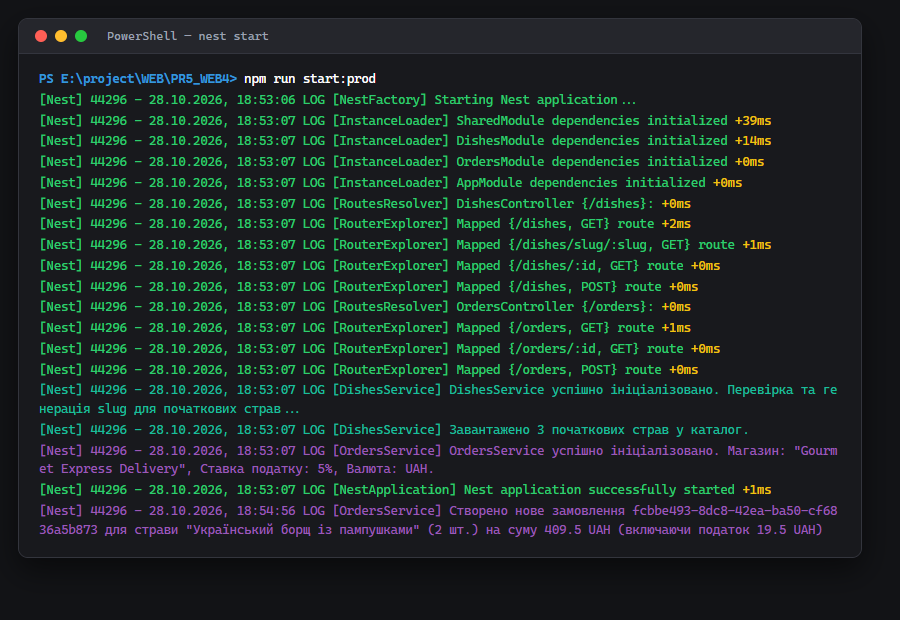
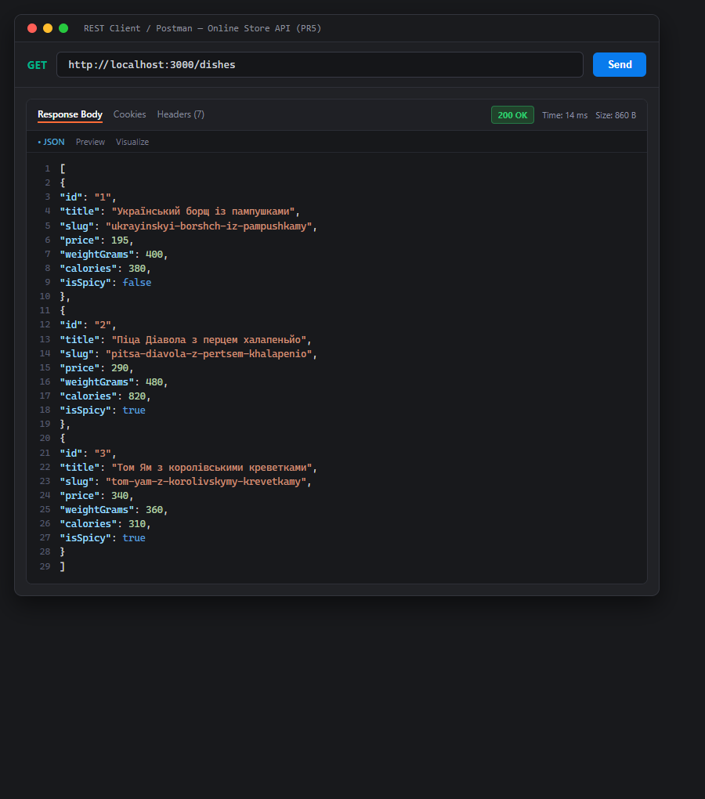
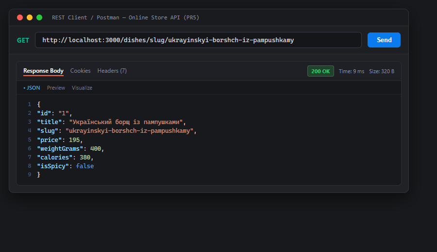
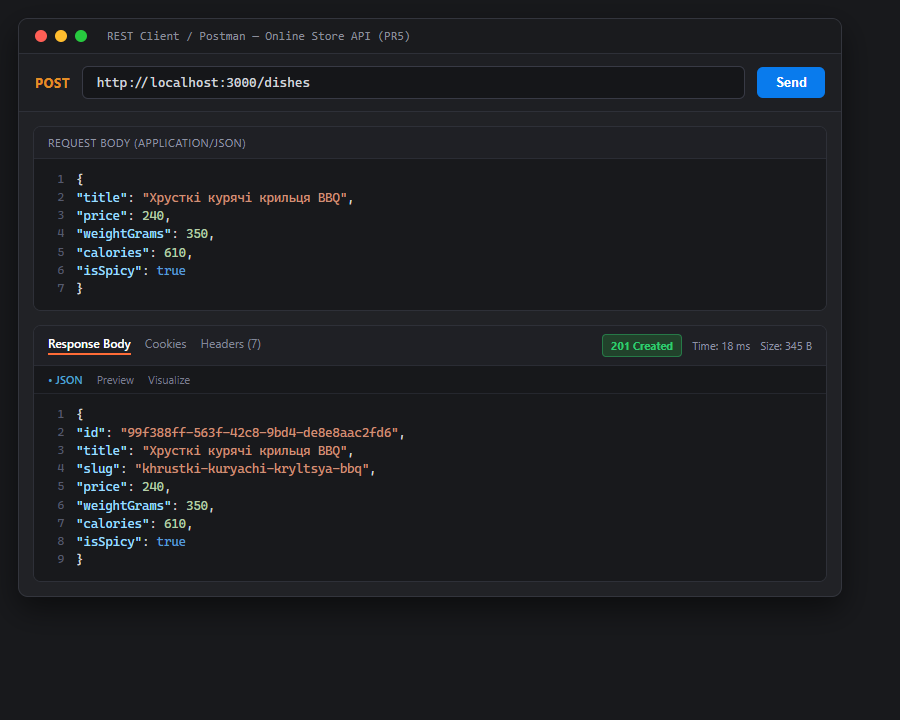
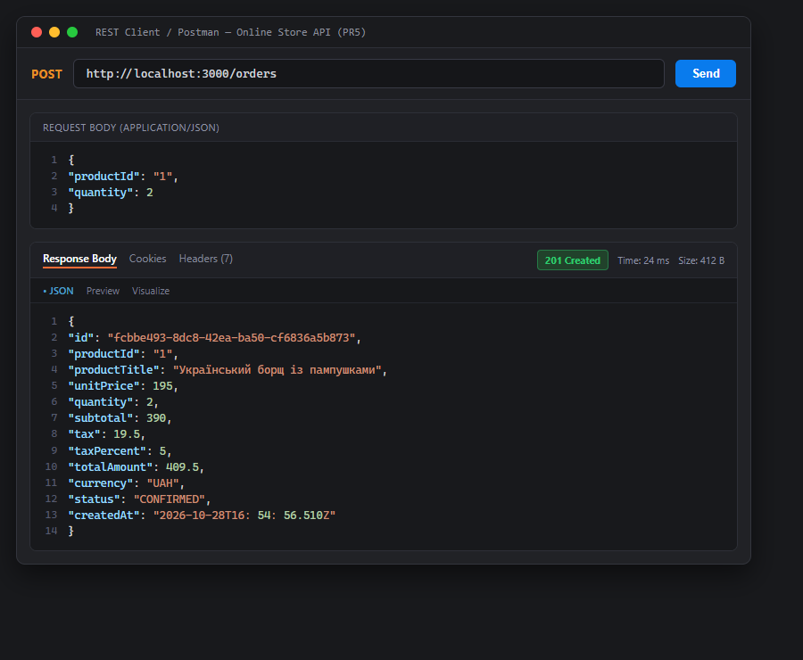
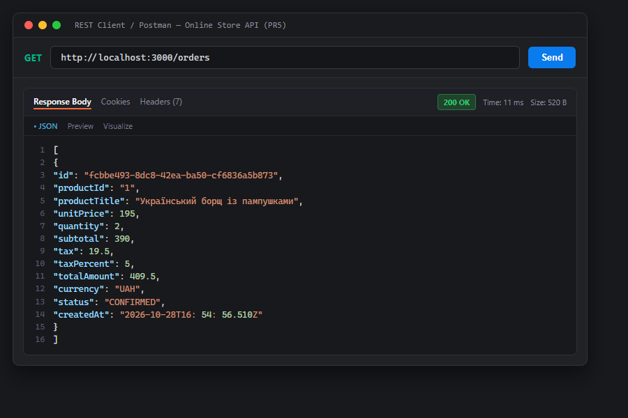
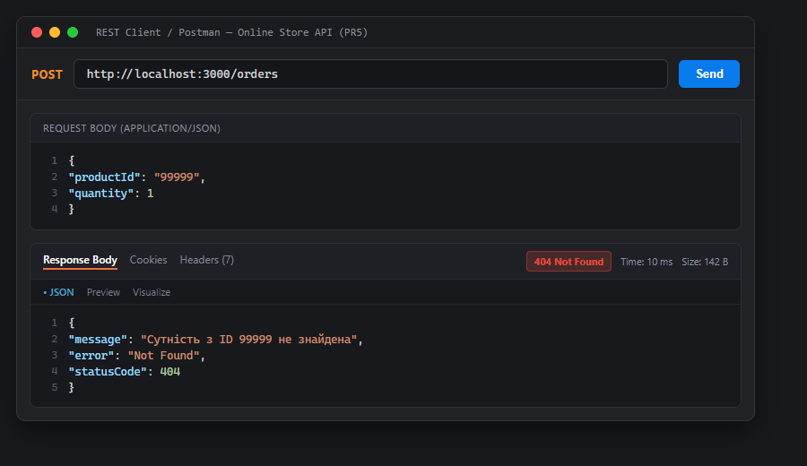
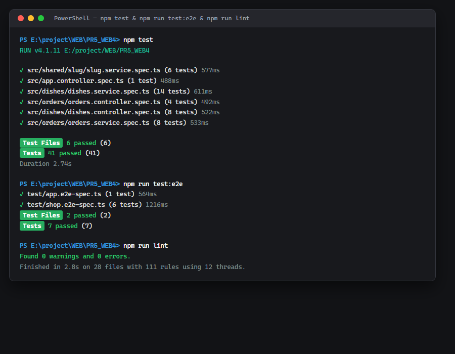

# Практична робота №5: Модульна архітектура та ін’єкція залежностей у NestJS

> **Дисципліна**: Розробка серверних веб-додатків (Web-технології)  
> **Тема**: Модульна архітектура, міжмодульний імпорт/експорт, Custom Providers (`useValue`, `useFactory`), Lifecycle Hooks (`OnModuleInit`) та ін'єкція залежностей (Dependency Injection) у NestJS.  
> **Варіант №4**: Сервіс доставки їжі та ресторанів — Каталог страв (`/dishes`) та модуль замовлень (`/orders`).

---

## 1. Мета роботи

1. **Опанувати принципи побудови модульної архітектури**: поділ системи на ізольовані функціональні модулі (*Feature Modules*: `DishesModule`, `OrdersModule`) та спільні утилітарні модулі (*Shared Modules*: `SharedModule`).
2. **Засвоїти механізми міжмодульного експорту та імпорту**: експорт сервісів через метадані `@Module({ exports: [...] })` та використання залежностей в інших модулях через `imports: [...]`.
3. **Реалізувати кастомні провайдери (Custom Providers)**:
   - Стратегія `useValue` для статичної конфігурації магазину під рядковим токеном `STORE_CONFIG`.
   - Стратегія `useFactory` з динамічною ін'єкцією залежностей (`inject: [STORE_CONFIG]`) для калькулятора податків/комісій під токеном `FEE_CALCULATOR`.
4. **Використати декоратор `@Inject()`** для впровадження кастомних провайдерів за строковими токенами ін'єкції.
5. **Опанувати хуки життєвого циклу NestJS**: використання інтерфейсу `OnModuleInit` та методу `onModuleInit()` для початкового наповнення каталогу (data seeding), генерації slug та логування конфігурації.
6. **Керування областями видимості провайдерів (Provider Scopes)**: розуміння принципів роботи `Scope.DEFAULT` (Singleton), `Scope.REQUEST` та `Scope.TRANSIENT`.

---

## 2. Архітектура та граф залежностей (Dependency Graph)

Додаток побудовано за тримодульною схемою відповідно до стандартів промислової розробки:

```
                            ┌─────────────────────┐
                            │      AppModule      │
                            └──────────┬──────────┘
                                       │ imports
             ┌─────────────────────────┼─────────────────────────┐
             │                         │                         │
             ▼                         ▼                         ▼
   ┌──────────────────┐      ┌──────────────────┐      ┌──────────────────┐
   │   DishesModule   │      │   OrdersModule   │      │   SharedModule   │
   │  (Feature Mod)   │      │  (Feature Mod)   │      │  (Shared/Common) │
   └────────┬─────────┘      └─────────┬────────┘      └─────────┬────────┘
            │                          │                         │
            │ imports                  │ imports                 │ exports:
            │                          ├─────────────────────────┼─ SlugService
            │                          │                         ├─ STORE_CONFIG
            │                          │                         └─ FEE_CALCULATOR
            ▼                          ▼
   ┌──────────────────┐       ┌─────────────────┐
   │  DishesService   │◀──────│  OrdersService  │
   │ (exports from    │  DI   │ (injects Dishes │
   │  DishesModule)   │       │  & Custom Prov) │
   └──────────────────┘       └─────────────────┘
```

### Структура каталогів проєкту

```text
PR5_WEB4/
├── src/
│   ├── dishes/                         # Feature Module 1: Страви / Каталог
│   │   ├── dto/
│   │   │   ├── create-dish.dto.ts      # DTO створення страви
│   │   │   └── update-dish.dto.ts      # DTO оновлення страви
│   │   ├── entities/
│   │   │   └── dish.entity.ts          # Модель сутності Dish (з полем slug)
│   │   ├── dishes.controller.ts        # REST контролер /dishes та /dishes/slug/:slug
│   │   ├── dishes.controller.spec.ts   # Unit-тести контролера
│   │   ├── dishes.service.ts           # Сервіс страв (OnModuleInit, Slug injection)
│   │   ├── dishes.service.spec.ts      # Unit-тести сервісу страв
│   │   └── dishes.module.ts            # Модуль: імпортує SharedModule, експортує DishesService
│   │
│   ├── orders/                         # Feature Module 2: Замовлення
│   │   ├── dto/
│   │   │   └── create-order.dto.ts     # DTO створення замовлення (productId, quantity)
│   │   ├── entities/
│   │   │   └── order.entity.ts         # Модель сутності Order
│   │   ├── orders.controller.ts        # REST контролер /orders
│   │   ├── orders.controller.spec.ts   # Unit-тести контролера замовлень
│   │   ├── orders.service.ts           # Сервіс замовлень (DishesService + Custom Providers)
│   │   ├── orders.service.spec.ts      # Unit-тести сервісу замовлень
│   │   └── orders.module.ts            # Модуль: імпортує DishesModule та SharedModule
│   │
│   ├── shared/                         # Shared Module: спільні сервіси та провайдери
│   │   ├── config/
│   │   │   ├── app-config.provider.ts      # useValue провайдер STORE_CONFIG
│   │   │   └── fee-calculator.provider.ts  # useFactory провайдер FEE_CALCULATOR
│   │   ├── slug/
│   │   │   ├── slug.service.ts         # Утилітарний сервіс генерації slug (транслітерація)
│   │   │   └── slug.service.spec.ts    # Unit-тести SlugService
│   │   └── shared.module.ts            # SharedModule: експорт SlugService, токенів конфігурації
│   │
│   ├── app.controller.ts               # Базовий контролер
│   ├── app.module.ts                   # Кореневий модуль (тільки імпорт модулів)
│   ├── app.service.ts                  # Базовий сервіс
│   └── main.ts                         # Точка входу в додаток
│
├── test/
│   ├── app.e2e-spec.ts                 # Базовий E2E тест
│   └── shop.e2e-spec.ts                # Комплексні E2E тести для /dishes та /orders
├── requests.http                       # Набір HTTP-запитів для розширення REST Client / Thunder Client
├── package.json
└── tsconfig.json
```

---

## 3. Деталізація реалізації за рівнями

### Рівень 1. Ізоляція Feature Module та створення Shared Module

1. **Ізоляція ресурсу страв (`DishesModule`)**:
   - Контролер `DishesController` та сервіс `DishesService` задекларовані виключно всередині `DishesModule`.
   - З кореневого `AppModule` видалено прямі оголошення сервісів і контролерів — `AppModule` відповідає суто за збирання графа модулів: `imports: [DishesModule, OrdersModule, SharedModule]`.

2. **Реалізація утилітарного сервісу `SlugService` у `SharedModule`**:
   - Сервіс виконує очищення та транслітерацію назв товарів у URL-безпечний рядок `slug` (наприклад, `"Український борщ із пампушками"` $\to$ `"ukrayinskyi-borshch-iz-pampushkamy"`).
   - Підтримує повну транслітерацію української абетки, заміну пробілів та спецсимволів на дефіси, нижній регістр та видалення дубльованих дефісів.
   - Зареєстрований у масиві `exports: [SlugService]` модуля `SharedModule`.

3. **Constructor Injection у `DishesService`**:
   - `SharedModule` імпортовано в `DishesModule`.
   - `SlugService` впроваджується через конструктор:
     ```typescript
     constructor(private readonly slugService: SlugService) {}
     ```
   - При виклику `create(createDishDto)` сервіс автоматично генерує та зберігає поле `slug`.
   - Реалізовано метод `findBySlug(slug: string)` та маршрут `GET /dishes/slug/:slug`.

4. **Хук `OnModuleInit`**:
   - Клас `DishesService` реалізує `OnModuleInit`. Під час старту додатка у методі `onModuleInit()` автоматично генеруються `slug` для всіх ініціалізаційних страв у сховищі та логується стан готовності.

---

### Рівень 2. Міжмодульна взаємодія та Custom Providers

1. **Міжмодульна взаємодія (`OrdersModule` $\to$ `DishesModule`)**:
   - `DishesModule` експортує `DishesService`: `exports: [DishesService]`.
   - `OrdersModule` додає `DishesModule` до списку `imports: [DishesModule, SharedModule]`.
   - У `OrdersService` через конструктор впроваджено `DishesService`:
     ```typescript
     constructor(
       private readonly dishesService: DishesService,
       @Inject(FEE_CALCULATOR) private readonly feeCalculator: FeeCalculator,
       @Inject(STORE_CONFIG) private readonly storeConfig: StoreConfig,
     ) {}
     ```
   - Метод `createOrder(dto)`:
     1. Перевіряє наявність сутності: `const dish = this.dishesService.findOne(dto.productId);`
     2. Якщо товар не знайдено — генерується `NotFoundException`.
     3. Розраховує базу: $\text{subtotal} = \text{dish.price} \times \text{dto.quantity}$.
     4. Обчислює податок через кастомний провайдер: $\text{tax} = \text{feeCalculator.calculateTax(subtotal)}$.
     5. Фіксує повну вартість: $\text{totalAmount} = \text{subtotal} + \text{tax}$.
     6. Зберігає замовлення у внутрішньому списку та повертає клієнту.

2. **Custom Provider зі стратегією `useValue` (`STORE_CONFIG`)**:
   - Файл: `src/shared/config/app-config.provider.ts`.
   - Токен: `export const STORE_CONFIG = 'STORE_CONFIG';`.
   - Об'єкт конфігурації:
     ```typescript
     export interface StoreConfig {
       storeName: string;
       defaultCurrency: string;
       taxPercent: number; // 5%
     }
     export const StoreConfigProvider: Provider = {
       provide: STORE_CONFIG,
       useValue: {
         storeName: 'Gourmet Express Delivery',
         defaultCurrency: 'UAH',
         taxPercent: 5,
       },
     };
     ```

3. **Custom Provider зі стратегією `useFactory` (`FEE_CALCULATOR`)**:
   - Файл: `src/shared/config/fee-calculator.provider.ts`.
   - Токен: `export const FEE_CALCULATOR = 'FEE_CALCULATOR';`.
   - Фабрика приймає токен `STORE_CONFIG` через масив `inject`:
     ```typescript
     export const FeeCalculatorProvider: Provider = {
       provide: FEE_CALCULATOR,
       useFactory: (config: StoreConfig): FeeCalculator => ({
         calculateTax: (amount: number): number => {
           const tax = (amount * config.taxPercent) / 100;
           return Math.round(tax * 100) / 100;
         },
       }),
       inject: [STORE_CONFIG],
     };
     ```
   - Провайдери експортуються з `SharedModule` та інжектуються у `OrdersService` через декоратор `@Inject()`.

---

## 4. Специфікація REST API маршрутів

### Модуль страв (`DishesController` — `/dishes`)

| Метод | URL-маршрут | Опис | Тіло / Параметри | Статус |
| :---: | :--- | :--- | :--- | :---: |
| `GET` | `/dishes` | Отримання переліку страв (з полями `slug`) | Query: `search`, `isSpicy`, `maxPrice` | `200 OK` |
| `GET` | `/dishes/slug/:slug` | Пошук страви за її згенерованим slug | Шлях: `:slug` | `200 OK` / `404 Not Found` |
| `GET` | `/dishes/:id` | Отримання страви за системним ID | Шлях: `:id` | `200 OK` / `404 Not Found` |
| `POST` | `/dishes` | Створення страви (автоматичний розрахунок slug) | `CreateDishDto` (JSON) | `201 Created` |
| `PATCH` | `/dishes/:id` | Оновлення полів страви (перерахунок slug при зміні назви) | `UpdateDishDto` (JSON) | `200 OK` / `404 Not Found` |
| `DELETE` | `/dishes/:id` | Видалення страви за ID | Шлях: `:id` | `204 No Content` / `404 Not Found` |

### Модуль замовлень (`OrdersController` — `/orders`)

| Метод | URL-маршрут | Опис | Тіло / Параметри | Статус |
| :---: | :--- | :--- | :--- | :---: |
| `POST` | `/orders` | Створення замовлення (перевірка страви в `DishesService` + податок) | `{"productId": "1", "quantity": 2}` | `201 Created` / `400` / `404` |
| `GET` | `/orders` | Перегляд списку всіх створених замовлень | — | `200 OK` |
| `GET` | `/orders/:id` | Отримання замовлення за ідентифікатором | Шлях: `:id` | `200 OK` / `404 Not Found` |

---

## 5. Інструкція із встановлення та запуску

### Системні вимоги
- **Node.js**: версія 18+ LTS (перевірено на Node v24.19.0)
- **Менеджер пакетів**: npm

### 1. Встановлення залежностей
```bash
npm install
```

### 2. Запуск проєкту у режимі розробки
```bash
npm run start:dev
```
Сервер запуститься за адресою: `http://localhost:3000`.

### 3. Збірка проєкту (Production Build)
```bash
npm run build
```

### 4. Запуск скомпільованого коду
```bash
npm run start:prod
```

### 5. Запуск статичного аналізу (Oxlint)
```bash
npm run lint
```

### 6. Запуск автоматизованих модульних та e2e тестів (Vitest)
```bash
# Модульні тести (Unit Tests)
npm test

# Наскрізні тести (E2E Tests)
npm run test:e2e
```

---

## 6. Демонстрація роботи програми та скриншоти

### 1. Ініціалізація додатку та хуки OnModuleInit
Під час старту NestJS розв'язує модульний граф, ініціалізує кастомні провайдери та викликає хуки `onModuleInit()` для сервісів `DishesService` (генерація slug) та `OrdersService` (логування конфігурації магазину):



---

### 2. Отримання каталогу страв із полями slug (`GET /dishes`)
Кожна страва повертається з автоматично згенерованим URL-безпечним полем `slug`:



---

### 3. Отримання сутності за згенерованим slug (`GET /dishes/slug/:slug`)
Демонстрація маршрутизації за slug, згенерованим утилітарним сервісом `SlugService`:



---

### 4. Створення нової страви із генерацією slug (`POST /dishes`)
При додаванні страви з українською назвою *"Хрусткі курячі крильця BBQ"* сервіс `SlugService` автоматично формує slug `"khrustki-kuryachi-kryltsya-bbq"`:



---

### 5. Створення замовлення через міжмодульний DI (`POST /orders`)
Сервіс `OrdersService` звертається до `DishesService.findOne("1")` для валідації страви, розраховує `subtotal` ($195 \times 2 = 390$), а за допомогою кастомного провайдера `FEE_CALCULATOR` (5% податок від `STORE_CONFIG`) нараховує $\text{tax} = 19.50\text{ грн}$ та підсумкову суму $\text{totalAmount} = 409.50\text{ грн}$:



---

### 6. Отримання списку замовлень (`GET /orders`)
Перегляд списку збережених у пам'яті замовлень:



---

### 7. Обробка помилки при замовленні неіснуючого товару (`404 Not Found`)
Коректна обробка виключення `NotFoundException`, коли `productId` відсутній у каталозі `DishesService`:



---

### 8. Результати автоматизованого тестування та перевірки лінтером
Усі **41 модульний тест** (включаючи `SlugService`, `DishesService`, `DishesController`, `OrdersService`, `OrdersController`), **7 наскрізних E2E тестів**, а також статичний аналізатор коду `oxlint` пройшли успішно з **0 помилок та 0 попереджень**:



---

## 7. Файл тестування `requests.http`

Для зручного тестування API через розширення **REST Client** або **Thunder Client** у VS Code створено файл [requests.http](requests.http), який містить готові сценарії для всіх контролерів:

```http
### Отримання всіх страв
GET http://localhost:3000/dishes HTTP/1.1

### Пошук страви за slug
GET http://localhost:3000/dishes/slug/ukrayinskyi-borshch-iz-pampushkamy HTTP/1.1

### Оформлення замовлення
POST http://localhost:3000/orders HTTP/1.1
Content-Type: application/json

{
  "productId": "1",
  "quantity": 2
}

### Перегляд замовлень
GET http://localhost:3000/orders HTTP/1.1
```

---

## 8. Висновки

1. У ході виконання практичної роботи реалізовано модульну архітектуру додатку на NestJS із чітким розмежуванням відповідальності між ізольованими Feature-модулями (`DishesModule`, `OrdersModule`) та спільним утилітарним модулем (`SharedModule`).
2. Опановано принципи інкапсуляції провайдерів за замовчуванням та організацію міжмодульного експорту/імпорту сервісів через метадані `@Module({ imports, exports })`.
3. Реалізовано кастомні провайдери із застосуванням стратегії `useValue` (статична конфігурація `STORE_CONFIG`) та `useFactory` з динамічним інжектуванням залежностей через `inject: [STORE_CONFIG]` для сервісу розрахунку податків `FEE_CALCULATOR`.
4. Використано хуки життєвого циклу `OnModuleInit` для виконання початкової ініціалізації та автоматичної генерації slug для каталогу сутностей.
5. Написано вичерпні unit-тести для всіх сервісів та контролерів (41 тест) та E2E тести (7 тестів). Код протестовано та перевірено лінтером без жодних зауважень.
